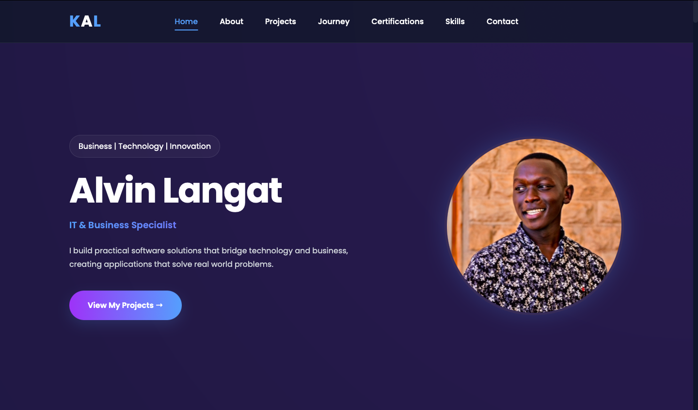

---

# 🌐 Alvin K. Langat | Portfolio Website

A modern, responsive portfolio website showcasing my software development projects, professional experience, certifications, and technical skills.

Built with performance, accessibility, and clean design in mind, this portfolio serves as my professional online presence and will continue evolving as I grow my experience and projects.

---

## ✨ Features

- Responsive design
- Modern and minimal interface
- Smooth scrolling navigation
- Scroll reveal animations
- Professional Journey
- Certifications
- Contact section
- Custom 404 page
- SEO-friendly metadata

---

## 🛠 Technologies

- HTML5
- CSS3
- JavaScript (ES6)
- Font Awesome
- Git & GitHub

---

## 📂 Project Structure

```
Portfolio/
│
├── assets/
│   ├── css/
│   ├── js/
│   ├── images/
│   ├── icons/
│   └── documents/
│  
│
├── index.html
├── 404.html
├── LICENSE
├── README.md
└── CHANGELOG.md
```

---

## 💻 Run Locally

```bash
git clone https://github.com/heisallaki/Portfolio.git
cd Portfolio
```

Open `index.html` in your browser, or run the project using VS Code Live Server.

---

## 🤝 Connect

**LinkedIn**  
https://www.linkedin.com/in/alvin-langat

**GitHub**  
https://github.com/heisallaki

**Email**  
alvinlangat.al@gmail.com

---


## License

**Proprietary License · All Rights Reserved**

Copyright © 2026 Alvin K. Langat. All rights reserved.

See the [`LICENSE`](LICENSE) file for the full copyright notice and usage restrictions.

---

## 👨‍💻 Author

**Alvin K. Langat**

Software Developer | Business Technology Enthusiast